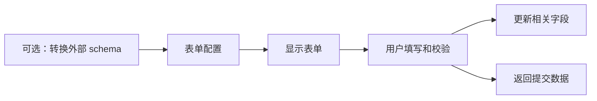

# DynamicForm 如何工作

你用配置描述表单字段和它们之间的关系，DynamicForm 根据配置显示表单、处理输入，并在提交时返回表单数据。下面介绍日常使用中最重要的几个环节。

## 选择合适的 package

- 在 React 应用中显示表单，使用 `@whynotsnow/dynamic-form`。它默认使用 Ant Design 展示字段、分组和提交按钮。
- 在表单显示之前校验或转换配置，例如在设计器保存前检查、或在服务端处理 schema，可以单独使用 `@whynotsnow/dynamic-form-core`。
- 如果已经在使用 `@whynotsnow/dynamic-form`，无需为了使用 core 更换已有 import。两者的适用场景见 [Core Package](./core-package.md)。

## 从配置到表单

大多数表单从 `fields` 开始；字段较多时可以用 `groups` 分区。需要嵌套提交数据或重复区块时，可以用 `nodes` 和 container。JsonSchema、OpenAPI 或自有 metadata 也可以先转换成 DynamicForm 配置，再交给表单显示。

配置转换是可选的。直接编写 `FormConfig` 的应用可以跳过它，直接把配置传给 `DynamicForm`。配置细节见[配置指南](./configuration.md)，外部数据转换见 [Adapter 与 Schema 指南](./adapter-foundation.md)。

## 字段标识和值的位置

每个字段用 `id` 在配置中保持唯一。需要控制提交对象中的值路径时，再设置 `name`；不设置时会继续使用 `id`。例如，container 的 `name: 'profile'` 可以让其中的 `name` 字段出现在 `values.profile.name`。

字段和分组主要负责组织展示；container 还可以为子字段添加值路径前缀。完整示例见 [Field Address](./field-address.md)。

## 联动、校验和提交

`dependents` 与 `effect` 可以让一个字段的变化更新其他字段。例如选择“有公司”后显示公司名称字段。内置规则也可以声明显示、隐藏、禁用、只读或赋值行为。它们适用于同步联动；远程请求等异步业务由应用自己的组件或服务处理。详见 [Effect 与处理器](./effects-and-handlers.md) 和 [Rule Engine](./rule-engine.md)。

默认情况下，隐藏字段不显示，也不会进入提交数据；禁用字段不参与校验。只读字段仍可校验。表单值和校验由底层表单运行时管理，DynamicForm 根据字段配置决定哪些值参与显示和提交。详见 [Runtime Layer](./runtime-layer.md)。

## 按需自定义展示

不需要自定义时，直接使用默认 Ant Design 展示。只改间距和按钮属性时使用 `uiConfig`；替换业务字段控件时使用 `componentRegistry`；调整局部或整体布局时使用 render hooks。接入另一套表单值管理或 UI 外壳时，再实现 `formAdapter` 或 `renderer`。详见[渲染与 UI 扩展](./rendering-and-ui.md)。
