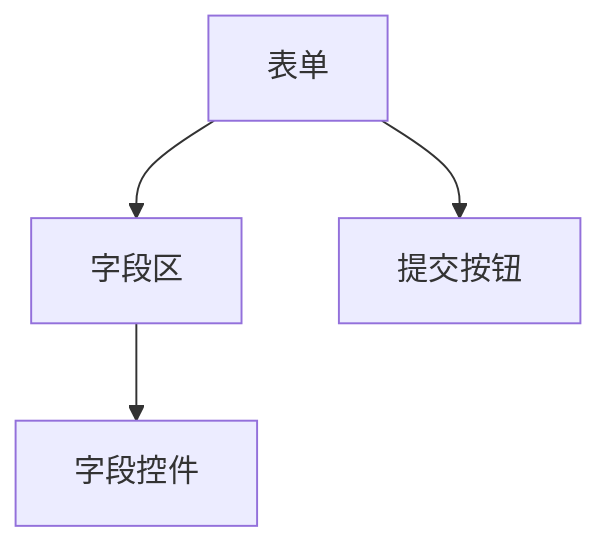
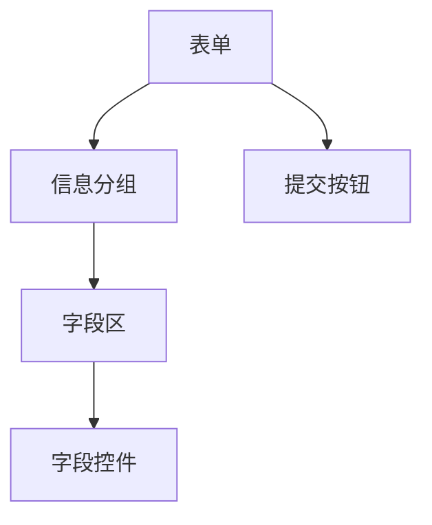

# 渲染与 UI 扩展

DynamicForm 默认用 Ant Design 显示表单。大多数应用直接使用默认展示即可；需要改变外观、字段控件或整体布局时，再选择下方对应的扩展方式。只有接入另一套表单数据管理或 UI 框架时，才需要实现 `formAdapter` 或 `renderer`。

| 你想调整什么 | 使用方式 |
| --- | --- |
| 间距、按钮或表单项属性 | `uiConfig` |
| 某种业务字段的输入控件 | `componentRegistry` |
| 字段外层、分组或整个表单布局 | render hooks |
| 表单值/校验来源或默认 UI 外壳 | `formAdapter` / `renderer` |

## 默认渲染结构

平铺表单：



分组表单：



默认展示使用 Ant Design 的表单、栅格、分组卡片和提交按钮。字段 `required: true` 会自动加入必填校验；如果 `rules` 中已经写了必填规则，则以显式规则为准。被隐藏或禁用的字段会按 [Runtime 规则](./runtime-layer.md)调整提交和校验行为。

## 4.1 Form / Renderer Adapter

这两个扩展入口都是可选的：

- `formAdapter`：告诉 DynamicForm 如何读取、更新和校验表单值。默认会把原有 Ant Design `form` 实例接入，因此已有用法无需变化。
- `renderer`：决定表单、字段、分组、重复区块和提交按钮如何显示。默认使用 `antdRenderer`。
- `assertFormAdapter` / `assertRendererAdapter`：检查自定义扩展是否提供了所需方法。

未传 `formAdapter` 时，`DynamicForm` 会把旧的 AntD `form` 实例转换为 `createAntdFormAdapter(form)`。未传 `renderer` 时，默认使用 `antdRenderer`。因此 4.0 的 AntD 用法继续兼容：

```tsx
<DynamicForm form={form} formConfig={formConfig} />
```

只有在接入其他组件库或自有 UI 外壳时，才需要传入自定义实现：

```tsx
<DynamicForm
  formAdapter={customFormAdapter}
  renderer={customRenderer}
  formConfig={formConfig}
/>
```

项目还提供两个用于示例、测试或预览的轻量实现：

- `createMemoryFormAdapter(initialValues)`：把值保存在内存中；`validateFields` 不会执行规则校验，适合测试和预览，不适合作为需要真实表单校验的生产表单。
- `headlessRenderer`：用浏览器原生的 `<form>`、`<label>` 和 `<button>` 等元素显示最小表单，便于理解 renderer 接口；它不提供完整的组件库体验。

注意：`@whynotsnow/dynamic-form` 当前仍声明 `antd` 为 peer dependency。即使传入 `headlessRenderer` 或自定义 renderer，也不会改变这个 package 安装要求。

4.1.2 明确 adapter 最低契约：

- `formAdapter.validateFields(names)` 必须接受 `FieldNamePath[]`，并只校验传入字段；如果底层表单库不支持局部校验，应在 adapter 内做兼容。
- `formAdapter.getFieldsValue(true)` 必须返回包含嵌套路径的完整 values；提交过滤由 DynamicForm 根据 Runtime 再处理。
- `renderer.renderForm()` 必须把 DynamicForm 提供的 `onFinish`、`onValuesChange` 和 `children` 接入底层表单外壳。
- `renderer.renderFieldItem()` 必须负责字段项外壳，并接收 renderer 生成的 `defaultRender`；render hooks 会在它之后继续包装或替换。
- 自定义 adapter 应先通过 `assertFormAdapter` / `assertRendererAdapter` 校验，再进入预览或生产渲染路径。

## 嵌套区块与重复列表

`nodes` 可以按配置顺序混合放置字段和区块：

- 字段会按顺序排列；container 默认显示为一张分组卡片，内部可以继续放字段或其他区块。
- repeatable container 使用 Ant Design `Form.List` 展示表单中已有的列表项，并为每一项生成相应的字段值路径。
- 默认展示不提供新增或删除列表项的按钮；请通过自己的界面和表单集成提供列表增删操作。

如果使用 `renderFields` 自定义布局，它会同时影响顶层字段、嵌套区块内字段和重复列表中的字段。

## 组件注册

通过 `componentRegistry` 注册业务字段组件。

```tsx
const componentRegistry = {
  customComponents: {
    ProjectSelect: ProjectSelectField
  },
  allowOverride: false
};

<DynamicForm form={form} formConfig={formConfig} componentRegistry={componentRegistry} />;
```

自定义组件会收到当前字段信息、字段值、变更回调和表单实例，也可以通过可选的 `formAdapter` 读写值：

```ts
interface FieldComponentProps {
  field: FieldState;
  value?: FieldValue;
  onChange?: (value: FieldValue) => void;
  form: unknown;
  formAdapter?: DynamicFormFormAdapter;
}
```

默认情况下，自定义组件不会覆盖内置组件。只有明确需要替换内置组件时，才设置 `allowOverride: true`。

## Render Hooks

需要替换默认布局时，可以从局部开始使用 render hooks：

| Hook              | 作用                             |
| ----------------- | -------------------------------- |
| `renderFieldItem` | 自定义单个字段项。               |
| `renderFields`    | 自定义字段列表。                 |
| `renderGroupItem` | 自定义单个分组。                 |
| `renderGroups`    | 自定义所有分组。                 |
| `renderFormInner` | 自定义整个表单 body 和提交区域。 |

每个 hook 都会收到默认结果 `defaultRender` 和下层渲染函数。通常可以在保留默认字段行为的基础上包一层；只有需要完全自定义时才返回全新的节点。

`renderer` 负责生成默认 UI，然后 render hooks 可以在对应层级包裹或替换它。自定义 renderer 不会关闭业务传入的 render hooks。

## 字段项扩展

```tsx
<DynamicForm
  form={form}
  formConfig={formConfig}
  renderFieldItem={({ field, defaultRender }) => {
    if (field.id !== 'username') return defaultRender;

    return (
      <div>
        <div style={{ marginBottom: 8 }}>Username is used for login.</div>
        {defaultRender}
      </div>
    );
  }}
/>
```

## 分组扩展

```tsx
<DynamicForm
  form={form}
  formConfig={formConfig}
  renderGroups={({ groupFields, renderGroupItem }) => {
    const items = Object.values(groupFields).map((group) => ({
      key: group.id,
      label: group.title ?? group.id,
      children: renderGroupItem(group)
    }));

    return <Tabs items={items} />;
  }}
/>
```

## 整体表单扩展

```tsx
<DynamicForm
  form={form}
  formConfig={formConfig}
  renderFormInner={({ fields, renderFields, defaultRender }) => (
    <>
      {renderFields([fields.name, fields.email].filter(Boolean))}
      {defaultRender.submitArea}
    </>
  )}
/>
```

## 扩展方式选择

- 只改默认 Ant Design props：使用 `uiConfig`。
- 字段控件本身有业务逻辑：使用 `componentRegistry`。
- 结构需要变化，例如 Tabs、特殊分组、自定义提交区：使用 render hooks。
- 需要接入另一套 Form 或 UI 外壳：实现 `formAdapter` 和 `renderer`。

默认渲染会自动处理字段的显示、禁用、只读和校验状态。若 hook 返回全新的 React 节点并绕过 `defaultRender`/下层渲染函数，业务代码需要自行保证相应行为仍然正确。
