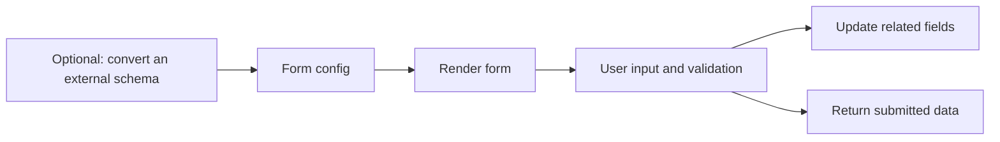

# How DynamicForm Works

You describe fields and their relationships in config. DynamicForm uses that config to display the form, handle input, and return submitted values. This page introduces the parts that matter in everyday use.

## Choose a Package

- To display forms in a React application, use `@whynotsnow/dynamic-form`. It uses Ant Design by default for fields, groups, and the submit button.
- To validate or convert config before displaying a form—for example, before saving it in a visual builder or processing a schema on a server—you can use `@whynotsnow/dynamic-form-core` on its own.
- If you already use `@whynotsnow/dynamic-form`, you do not need to change existing imports to use core. See [Core Package](./core-package.md) for guidance on when each package fits.

## From Config to Form

Most forms start with `fields`; use `groups` to divide a larger form into sections. Use `nodes` and containers for nested submitted data or repeated sections. You can also convert JsonSchema, OpenAPI, or your own metadata into DynamicForm config before rendering it.

Config conversion is optional. If you write `FormConfig` directly, skip it and pass the config to `DynamicForm`. See the [Configuration Guide](./configuration.md) for config details and [Adapter and Schema Guides](./adapter-foundation.md) for external input conversion.

## Field Identity and Value Paths

Each field has a unique `id` in config. Set `name` when you need to control where its value appears in submitted data; if omitted, it continues to use `id`. For example, a container with `name: 'profile'` can place a child field named `name` at `values.profile.name`.

Fields and groups mainly organize what users see. A container can also add a value-path prefix for its child fields. See [Field Address](./field-address.md) for examples.

## Effects, Validation, and Submission

Use `dependents` and `effect` to let one field update another. For example, selecting “has a company” can show a company-name field. Built-in rules can also show, hide, disable, make a field read-only, or set a value. These features handle synchronous updates; use your own components or services for asynchronous work such as network requests. See [Effects and Handlers](./effects-and-handlers.md) and [Rule Engine](./rule-engine.md).

By default, hidden fields are not displayed or included in submitted data, and disabled fields are not validated. Read-only fields can still be validated. The underlying form runtime manages values and validation; DynamicForm uses field config to determine what is displayed and submitted. See [Runtime Layer](./runtime-layer.md).

## Customize the Presentation When Needed

Use the default Ant Design presentation unless you need to change it. Use `uiConfig` for spacing and button props, `componentRegistry` to replace a business field control, and render hooks to adjust part or all of the layout. Implement `formAdapter` or `renderer` only when connecting another form-state system or UI shell. See [Rendering and UI Extensions](./rendering-and-ui.md).
