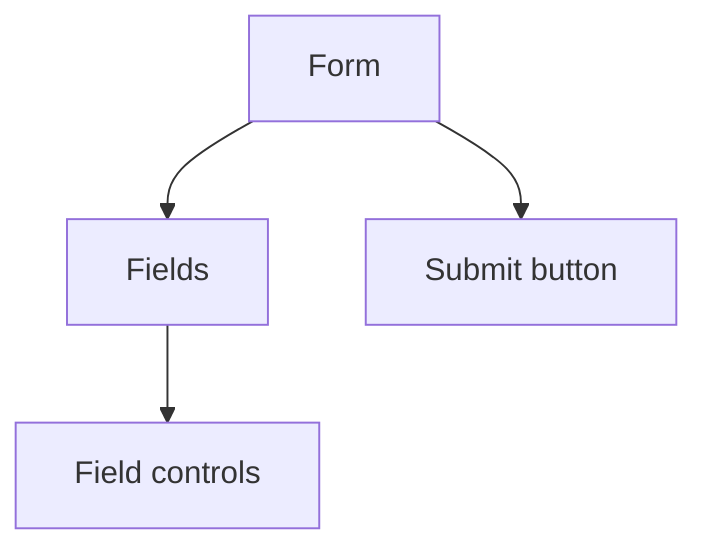
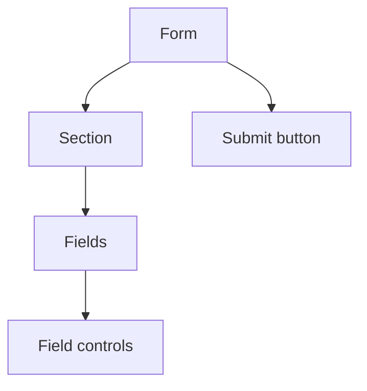

# Rendering and UI Extensions

DynamicForm uses Ant Design to display forms by default. Most applications can keep the default presentation. Choose one of the extension points below when you need to change appearance, field controls, or layout. Implement `formAdapter` or `renderer` only when connecting another form-state system or UI framework.

| What you want to change | Use |
| --- | --- |
| Spacing, buttons, or form-item props | `uiConfig` |
| The input control for a business field | `componentRegistry` |
| A field wrapper, groups, or the overall form layout | Render hooks |
| The source of form values/validation or the default UI shell | `formAdapter` / `renderer` |

## Default Rendering

Flat forms:



Grouped forms:



The default presentation uses Ant Design forms, grid layout, group cards, and a submit button. A field with `required: true` automatically gets a required rule; an explicit required rule in `rules` takes precedence. Hidden and disabled fields follow the submission and validation rules described in [Runtime Layer](./runtime-layer.md).

## 4.1 Form / Renderer Adapter

Both extension points are optional:

- `formAdapter`: tells DynamicForm how to read, update, and validate form values. The default adapter connects the existing Ant Design `form` instance, so current usage does not need to change.
- `renderer`: controls how the form, fields, groups, repeated sections, and submit button are displayed. The default is `antdRenderer`.
- `assertFormAdapter` / `assertRendererAdapter`: check that a custom extension provides the required methods.

When `formAdapter` is omitted, `DynamicForm` converts the legacy AntD `form` instance with `createAntdFormAdapter(form)`. When `renderer` is omitted, it uses `antdRenderer`. Existing 4.0 AntD usage remains compatible:

```tsx
<DynamicForm form={form} formConfig={formConfig} />
```

Pass custom implementations only when connecting another component library or a UI shell of your own:

```tsx
<DynamicForm
  formAdapter={customFormAdapter}
  renderer={customRenderer}
  formConfig={formConfig}
/>
```

The project also provides two lightweight implementations for examples, tests, and previews:

- `createMemoryFormAdapter(initialValues)`: keeps values in memory. Its `validateFields` does not run validation rules, so use it for tests and previews rather than production forms that need real validation.
- `headlessRenderer`: uses native browser elements such as `<form>`, `<label>`, and `<button>` to demonstrate the renderer interface. It does not provide a full component-library experience.

Note: `@whynotsnow/dynamic-form` currently declares `antd` as a peer dependency. Passing `headlessRenderer` or a custom renderer does not change that package installation requirement.

4.1.2 clarifies the minimum adapter contract:

- `formAdapter.validateFields(names)` must accept `FieldNamePath[]` and validate only those fields. If the underlying form library does not support partial validation, the adapter should provide the compatibility layer.
- `formAdapter.getFieldsValue(true)` must return the complete values object including nested paths. DynamicForm applies submit filtering later through Runtime.
- `renderer.renderForm()` must wire the supplied `onFinish`, `onValuesChange`, and `children` into the underlying form shell.
- `renderer.renderFieldItem()` must own the field item shell and receive the renderer-generated `defaultRender`; render hooks may wrap or replace it afterward.
- Custom adapters should pass `assertFormAdapter` / `assertRendererAdapter` before entering preview or production rendering paths.

## Nested Sections and Repeated Lists

Use `nodes` to mix fields and sections in the order you want:

- Fields appear in order. A container appears as a section card by default and can contain fields or other sections.
- A repeatable container uses Ant Design `Form.List` to display the list items already in the form and create the corresponding value path for each item.
- The default presentation does not provide add or remove buttons. Add those operations through your own UI and form integration.

If you use `renderFields` to customize layout, it also applies to fields at the top level, inside nested sections, and inside repeated lists.

## Component Registry

Use `componentRegistry` to register business-specific field components. A custom component receives the current field, its value, a change callback, and the form instance. It can also use the optional `formAdapter` to access values.

By default, custom components do not replace built-ins. Set `allowOverride: true` only when replacement is intentional.

## Render Hooks

Use render hooks when you need to replace a default layout, starting with the smallest area you need to change:

- `renderFieldItem`: customize one field item.
- `renderFields`: customize a field list.
- `renderGroupItem`: customize one group.
- `renderGroups`: customize all groups.
- `renderFormInner`: customize the full form body and submit area.

Each hook receives `defaultRender` and lower-level render functions. Usually you can wrap the default field behavior; return a new node only when you need a complete replacement.

The `renderer` creates the default UI first. Render hooks can then wrap or replace it at the corresponding level. A custom renderer does not disable render hooks.

## Choosing an Extension Point

Use `uiConfig` when the default structure is still correct and only Ant Design props need to change. Use `componentRegistry` when the field input itself is business-specific. Use render hooks when the layout structure needs to change. Implement `formAdapter` and `renderer` when another Form runtime or UI shell needs to be connected.

Default rendering handles field visibility, disabled/readonly state, and validation participation. If a hook returns a new React node and bypasses `defaultRender` and the lower-level render functions, application code must preserve the needed behavior itself.
